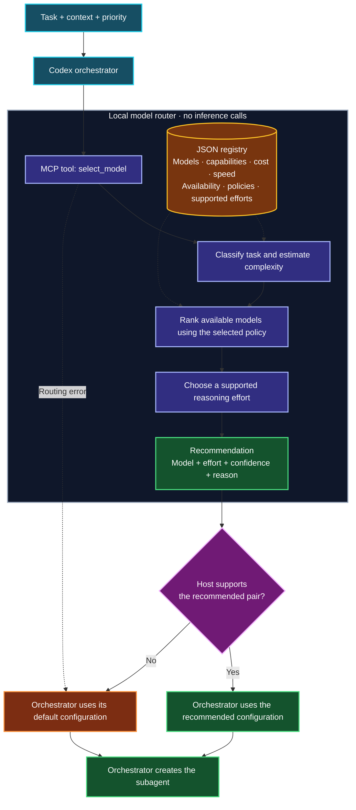

# agent-model-router

A local-first MCP server and TypeScript library that recommend a model and
reasoning effort for a delegated coding task. The orchestrator asks for a
recommendation and starts its own agent. **This server never starts agents.**

No API key, inference request, account lookup, telemetry or routing fee. Models,
capability ratings, relative cost/speed, availability and policies live in JSON.
MIT licensed. Requires Node.js 22 or newer.

## How it works



**Purple:** local routing. **Amber:** configuration. **Green:** recommendation
and orchestrator action. **Orange:** fallback. Only the orchestrator creates agents.

## Run locally

```sh
git clone https://github.com/Intelligent-Intern/agent-model-router.git
cd agent-model-router
npm ci
npm run build
node dist/cli.js select \
  --task "Find potential race conditions in this codebase" \
  --context "TypeScript backend, distributed workers" \
  --priority balanced
```

The bundled example registry returns:

```json
{
  "model": "gpt-6.1-terra",
  "reasoning_effort": "high",
  "confidence": 0.8128,
  "reason": "Concurrency and distributed-system analysis Complexity 0.70; balanced policy selects gpt-6.1-terra (capability 0.93) with high effort."
}
```

`confidence` measures heuristic separation and category evidence. It is **not**
a calibrated success probability. Registry numbers are illustrative weights,
not actual prices, latency measurements or benchmark claims.

## MCP: `select_model`

Start the local stdio server:

```sh
node dist/cli.js serve
# Or use an explicit, complete registry snapshot:
node dist/cli.js serve --config /absolute/path/router.json
```

The server reserves stdout for MCP. Startup/CLI errors go to stderr. Invalid
configuration exits with a nonzero status; it never silently loads another file.
The official MCP TypeScript SDK v2 handles initialization and protocol negotiation,
including legacy stdio clients.

Input:

```json
{
  "task": "Find potential race conditions in this codebase",
  "context": "TypeScript backend, distributed workers",
  "priority": "balanced"
}
```

- `task`: required nonblank string, at most 20,000 characters.
- `context`: optional string, at most 40,000 characters; defaults to empty.
- `priority`: `quality`, `balanced`, `speed`, or `cost`; defaults to `balanced`.
- `available_models`: optional model-ID array supplied by the host. Intersects
  registry availability. An empty array means **no available models**.
- Unknown input keys are rejected.

Output has `model`, `reasoning_effort`, `confidence`, and `reason`, both as MCP
`structuredContent` and JSON text. If no model is available, the tool returns an
MCP error rather than fabricating a recommendation. The orchestrator then uses
its own default configuration. Invalid arguments are rejected by the MCP SDK.

## Codex setup

Merge [examples/codex/config.toml](examples/codex/config.toml) into your project's
`.codex/config.toml`, replacing its absolute paths. Copy or merge
[examples/codex/AGENTS.md](examples/codex/AGENTS.md) into your own instructions.
No user-level configuration is modified by this package.

The instructions require routing before authorized delegation and applying the
recommendation only through fields the host actually supports. On a host without
per-agent overrides, use a configured role or inherit defaults. If routing or an
override fails, fall back once to default delegation. The router does not bypass
delegation restrictions.

[Codex compatibility verification](docs/codex-compatibility.md) records the live
interface inspected, the installed CLI version, supported overrides in that
session, and the distinction between tool parameters and config-file settings.
See also the [official Codex subagent documentation](https://learn.chatgpt.com/docs/agent-configuration/subagents).

## CLI

```sh
# Pipe a request; CLI flags override the corresponding JSON fields.
printf '%s' '{"task":"Add unit tests","priority":"cost"}' | node dist/cli.js select

# Inspect classification, complexity, every candidate score and fallback warnings.
node dist/cli.js select --task "Review security across services" --explain

# Limit recommendations to the host's known model IDs.
node dist/cli.js select --task "Refactor the parser" \
  --available-models gpt-6.1-sol,gpt-6.1-terra

node dist/cli.js validate --config config/default.json
node dist/cli.js --help
npm run demo
```

CLI success exits 0. Invalid input/configuration and routing failures exit 1.
Input from stdin is bounded to 256 KiB; configuration is bounded to 1 MiB.

## Standalone library

The library can be imported without creating an MCP server:

```ts
import { HeuristicRouter, loadConfig } from 'agent-model-router';

const router = new HeuristicRouter(await loadConfig());
const recommendation = router.select({
  task: 'Review distributed workers for race conditions',
  priority: 'quality',
});
console.log(recommendation);

const explanation = router.explain({ task: 'Fix a typo in README', priority: 'cost' });
console.log(explanation.analysis, explanation.candidates, explanation.warnings);
```

For an already-loaded JSON snapshot, use `new HeuristicRouter(snapshot)`.
The constructor validates and copies configuration. Each request is independent
and deterministic for the same snapshot and input. There is no request history,
file watching or implicit registry refresh.

`createMcpServer(router)` is exported from `agent-model-router/mcp`. It accepts the
`ModelRouter` interface, including async implementations. The default engine
uses replaceable `TaskAnalyzer` and `ModelRanker` interfaces. A future remote API,
benchmark ranker or hosted registry can use these boundaries without changing
MCP or implementing a SaaS backend in this package.

## Configure the registry

Copy [config/default.json](config/default.json), edit it, then run `validate`.
The configuration is a full replacement, not a partial override. Schema version
1 rejects unknown keys. Referential and policy checks run at load/construction.

Each model declares:

| Field | Meaning |
| --- | --- |
| `id`, `provider` | Opaque identifiers; routing contains no provider/model-name branches |
| `reasoning_levels` | Supported levels, ordered using global `effort_order` |
| `relative_cost` | Positive relative cost; lower is cheaper |
| `relative_speed` | 0–1 speed preference; higher is faster |
| `max_complexity` | Highest estimated complexity the model is configured to handle |
| `capabilities` | 0–1 capability rating for each declared task category |
| `available` | Operator-controlled availability flag |

`classification` defines category descriptions and weighted literal phrases.
`complexity` defines a baseline and weighted signals. Each priority has quality,
speed and cost weights, quality floors and effort thresholds. `fallback` defines
a registered model and supported effort.

The sample uses model IDs exposed in the implementation session. Verify them in
your own host; they are not universally available. To use another provider,
replace the IDs/provider metadata, supported efforts and ratings. No provider API
is called. Relative figures influence policy decisions, not billing.

See [architecture and scoring](docs/architecture.md) for the exact formula,
effort mapping, tie-breaking and extension points.

## Fallbacks and failure handling

- Unknown category: configured fallback, confidence 0.3, explicit reason.
- No model meets quality/complexity requirements: degraded fallback, explicitly
  identified in the reason and full explanation.
- Configured fallback unavailable: highest-scoring available model.
- Requested effort unsupported: next supported level up, or highest supported
  level when no higher level exists. The explanation records the mapping.
- Nothing available: `NoModelAvailableError` in the library; nonzero CLI exit;
  MCP tool error. The orchestrator decides whether to inherit its default.
- Invalid configuration: fail startup. Existing router instances retain their
  validated snapshot and are unaffected by edits to the source file.

## Twelve example decisions

These are deterministic outputs from `npm run demo` with the bundled example
registry, not quality benchmarks:

| Task | Priority | Model | Effort |
| --- | --- | --- | --- |
| README typo | cost | gpt-6-luna | low |
| Unit tests for a small helper | cost | gpt-6-luna | low |
| JSON parser with validation | balanced | gpt-6.1-sol | low |
| Responsive Vue/CSS layout | speed | gpt-6-luna | low |
| Authentication refactor across a monorepo | balanced | gpt-6.1-terra | high |
| Race conditions in distributed workers | quality | gpt-6-astra | xhigh |
| Production deadlock across services | balanced | gpt-6.1-terra | xhigh |
| Security and authorization review | quality | gpt-6-astra | high |
| Distributed consensus and invariants | quality | gpt-6-astra | max |
| Database migration with data-loss risk | balanced | gpt-6.1-terra | high |
| Simple API documentation | speed | gpt-6-luna | low |
| Unspecified request | balanced | gpt-6.1-sol | medium |

The runnable inputs are in [examples/tasks.json](examples/tasks.json).

## Development and package verification

```sh
npm ci
npm run check      # ESLint, strict TypeScript, build, Node unit/integration tests
npm run demo       # twelve routing decisions
npm pack --dry-run # inspect the publishable artifact, without publishing
npm pack           # create a local tarball; does not publish
```

Tests cover deterministic ranking, configuration validation, availability,
fallbacks, effort support, Unicode boundaries, isolation, CLI errors and real
MCP stdio initialization/tool calls. GitHub Actions runs the same checks on
Node 22 and 24. No secrets, API key or inference budget are required.

To install a locally built tarball:

```sh
npm install ./agent-model-router-0.1.0.tgz
npx --no-install agent-model-router select --task "Add unit tests" --priority cost
```

The package includes built JS/declarations, registry, documentation, examples and
license. Its `prepack` hook builds TypeScript. There is no automatic release or
npm publication workflow.

## Limitations and assumptions

- Heuristics match configured phrases, not intent. Negation, quoted instructions,
  unusual wording, multilingual tasks without matching configured phrases and
  misleading context can produce poor classifications. Unknown wording falls
  back. Task text is data; the router executes no instructions from it.
- The engine never inspects the repository, runs benchmarks or checks account
  entitlements. Its recommendation is only as good as the supplied description,
  ratings and availability snapshot. It cannot prove a globally optimal choice.
- Relative cost/speed and capability ratings are examples. Effort-specific token
  costs and latency, rate limits, quotas and live health are not modeled.
- Confidence is uncalibrated. A high value is not a guarantee of correctness.
- The host can ignore or reject a recommendation. An AGENTS.md file guides the
  orchestrator; it is not a technical enforcement mechanism.
- Reasoning labels and model availability differ across providers and Codex hosts.
  Configure the registry and inspect the actual delegation tool schema.
- V1 implements local stdio only. HTTP hosting, authentication, billing, analytics,
  feedback storage, registry downloads and LLM routing are not implemented.

## Contributing

Open an issue or pull request with a reproducible routing input, configuration
revision and expected behavior. Run `npm run check` and update the examples when
changing policies. Avoid committing private task descriptions or credentials.

## License

[MIT](LICENSE).
