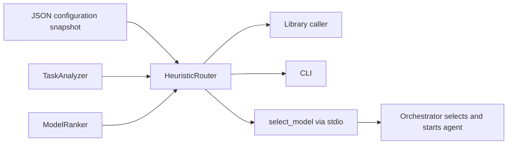

# Architecture



`schema.ts` defines bounded input and configuration contracts. Referential checks
reject duplicate IDs, invalid fallback references, incomplete capabilities,
unknown efforts and unordered thresholds. Configuration is a complete snapshot;
there is no implicit merging, download, hot reload, or environment discovery.
Each router instance parses its own snapshot and holds no request state.

`HeuristicAnalyzer` normalizes Unicode and searches literal, word-delimited
phrases from JSON in task and context. Each matching signal contributes its
weight once. The highest category score wins, ties use ascending IDs, and unknown
tasks use the declared default category. Complexity is the baseline plus matching
complexity signals, clamped to [0, 1]. Phrase order is irrelevant. Classification
is deliberately simple: no syntax tree, repository inspection or inference.

`WeightedRanker` filters unavailable models before ranking. Caller availability
is an additional intersection, never an override. It computes:

```text
quality_weight = policy.weights.quality + policy.complexity_weight_bonus * complexity
cost_utility = 1 - (relative_cost - min_cost) / (max_cost - min_cost)
score = (quality_weight * category_capability
       + policy.weights.speed * relative_speed
       + policy.weights.cost * cost_utility) / sum(effective_weights)
minimum_quality = clamp(policy.min_quality + policy.complexity_quality_bonus * complexity)
```

Equal costs receive equal utility. Scores are rounded to four decimals before
sorting; ascending model IDs break ties. The costs are relative within the
available set. A model must also support the estimated complexity and meet the
quality floor. Priority selects policy, not model IDs in code.

Effort comes from the first policy threshold covering the complexity. If that
effort is unsupported, select the next supported level up; otherwise select the
highest supported level. The configured global effort order defines this
comparison; effort labels are not embedded in the algorithm. Effort does not
change a model's capability rating in v1.

Unknown tasks and unsatisfied quality floors use the configured fallback if
available, otherwise the highest-scoring available model. The latter can be a
degraded recommendation; it is called out in the reason and explanation. When
nothing is available, throw `NoModelAvailableError`. Never recommend a disabled
or invented model. Invalid configuration fails startup rather than silently
using a different registry.

Confidence is an uncalibrated heuristic: 0.55 baseline + a capped score margin
(up to 0.2) + capped category evidence (up to 0.2), capped overall at 0.95.
Fallback confidence is 0.3. It is not a measured probability of task success.

## Extension boundaries

- Implement `TaskAnalyzer` to replace classification/complexity estimation.
- Implement `ModelRanker` to rank with offline benchmark data.
- Implement `ModelRouter` for a different strategy, including an async one;
  `createMcpServer` accepts that interface without knowing the strategy.
- A future hosted registry supplies a validated snapshot to the constructor.
- Team-specific policies are separate JSON snapshots, not branches in core.
- `explain()` exposes registry revision, signals, scores and fallback warnings.
  A future caller can attach feedback/analytics externally. V1 does not store,
  transmit, log or collect them.

The default implementation never calls network APIs, tools or agents. The stdio
adapter is local-only; an HTTP API, hosted registry, authentication, billing,
telemetry and LLM-based routing are outside v1. Installing npm dependencies is a
build-time network operation; routing after installation has none.
